<p align="center">
  
</p>

<p align="center">
  <a href="https://github.com/umairmsm/agent-loop-kit/actions"></a>
  <a href="https://opensource.org/licenses/MIT"></a>
  <a href="https://github.com/umairmsm/agent-loop-kit/issues"></a>
  <a href="https://claude.ai"></a>
</p>

<p align="center">
  <b>Autonomous multi-agent supervision loop:</b> Builder agents write code step-by-step; Claude Code independently gates, tests, and reviews each commit before it lands.
</p>

---

## ⚡ Product Proof in Motion

Watch `agy-loop` execute an autonomous task: the Builder authors a step commit, the detached-worktree mechanical gate verifies test suite integrity in 1.4s, and Claude Code accepts the diff:

<p align="center">
  
</p>

---

## 1. The Problem: Why Single-Agent Coding Breaks

When you ask an autonomous AI coding agent to complete a multi-step project on its own, it behaves like an over-eager student without a teacher:
* **Grades its own homework**: Tests its own code in the working tree and happily claims victory.
* **Silently deletes failing tests**: Disables assertions or skips tests when stuck, claiming a "green" build.
* **Infinite hallucination loops**: Gets stuck repeating the same syntax bug for 30 turns.
* **Unsafe shell execution**: Leaks API keys or executes destructive filesystem commands.

### The Contrast Matrix

| The Fragile Single-Agent Way ❌ | The `agent-loop-kit` Gated Way ✅ |
|---|---|
| **Grades Its Own Homework**: Single agent runs tests in its dirty working tree. | **Separation of Powers**: Builder writes; Reviewer tests in a detached, ephemeral worktree. |
| **Silent Test Deletion**: Agent weakens or deletes test assertions to force a "green" build. | **Zero-Deletion Mechanical Gate**: `gate.sh` blocks commit if tests are weakened or removed. |
| **Infinite Error Loops**: Model gets stuck in repetitive syntax or API hallucinatory loops. | **Multi-Model Second Opinion**: Automatic quota failover (Claude Code ⟷ Gemini ⟷ DeepSeek). |
| **Messy Squash Bloat**: 20 failed half-attempts pollute git history. | **Atomic Clean Step Commits**: Only verified, reviewer-accepted steps reach `main`. |

---

## 2. Architecture: Separation of Powers

Instead of trusting one agent to do everything, `agent-loop-kit` divides responsibility between two independent agents:

```mermaid
stateDiagram-v2
    direction LR
    [*] --> BuilderAgent : Dispatch Step N

    state BuilderAgent {
        direction TB
        SpecAnalysis : 1. Read Step Specification
        WriteCode : 2. Implement Changes
        AuthorTests : 3. Write Unit Test Assertions
        StageCandidateDiff : 4. Create Step Candidate Commit
    }

    BuilderAgent --> EphemeralWorktreeGate : Candidate Commit

    state EphemeralWorktreeGate {
        direction TB
        ASTCheck : AST Syntax Validation
        ShellCheck : Linter & Code Hygiene
        TestRunner : 100% Passing Test Suite
        AntiDeletion : Zero Test Deletions Guard
    }

    EphemeralWorktreeGate --> BuilderAgent : ✗ Gate Failed (Auto-Retry in Turn)
    EphemeralWorktreeGate --> ReviewerAgent : ✓ Gate Passed (Diff Clean)

    state ReviewerAgent {
        direction TB
        SpecAudit : Audit Diff vs Spec
        MutationCheck : Adversarial Mutation Probe
        MultiModel : Second Opinion Consensus
    }

    ReviewerAgent --> BuilderAgent : ✗ REVISE (Actionable Review Feedback)
    ReviewerAgent --> LandToMain : ✓ ACCEPT (Atomic Landing)

    LandToMain --> [*] : Advance to Step N+1
```



1. **The Builder** (Antigravity / Codex / Aider): Works on a feature branch, implementing code and tests one step at a time.
2. **The Reviewer** (Claude Code): Operates in an isolated worktree. Mechanically runs test suites, linters, probes (`gate.sh`), adversarial security mutations, and reviews diffs against the written spec.

**The human supervisor only reviews and merges when the entire task is finished.**

---

## 3. 5-Minute Quickstart

### Prerequisites
- Bash (Linux / macOS / WSL2)
- Git (2.28+)
- Python 3.10+
- [Gitleaks](https://github.com/gitleaks/gitleaks) & [ShellCheck](https://www.shellcheck.net/)

### Installation
Clone this repository and run the link installer:
```bash
git clone https://github.com/umairmsm/agent-loop-kit.git
cd agent-loop-kit
bash bin/install-links.sh --loop
```
This symlinks the CLI tools (`agent-loop` / `loop`, `agy-loop`, `agy-safe`, `agy-resume`, `agy-sessions`) into `~/.local/bin` and registers the `agent-supervisor` skill with Claude Code.

### Try the Demo
Test the gate and evidence engine in under 30 seconds:
```bash
cd examples/demo-project
./run-demo.sh
```
You will see `gate.sh` create a detached worktree, run the test suite, scan for secrets, and write `.supervision/evidence/<sha>.txt`.

---

## 4. How It Works

### The Supervision State Machine
Every task is defined in a structured specification (see [`docs/SPEC_TEMPLATE.md`](docs/SPEC_TEMPLATE.md)).
1. **The Step Commit**: The Builder executes Step N, runs project tests, and commits once with a Conventional Commit message.
2. **Status Handoff**: The Builder writes `.supervision/ag_status.json` with state `READY_FOR_REVIEW`.
3. **The Mechanical Gate (`gate.sh`)**: The Reviewer checks out the commit in a throwaway detached git worktree (`git worktree add --detach`) so the Builder's shared working tree is never touched. It runs:
   - Environment & runtime sanity checks
   - Full test suite (`TEST_CMD`)
   - Linter & formatter (`LINT_CMD`, `FORMAT_CMD`)
   - Secret scan (`gitleaks`)
   - Test-deletion detector: compares test counts and names against the base branch. If the builder deleted or skipped tests, the gate fails immediately.
   - Project probes: custom scripts verifying specific bugs stay fixed.
4. **Multi-Brain Reviewer Cascade (`supervisor-router`)**: The Reviewer runs an adversarial inspection using the best available high-IQ model. If Claude hits subscription limits or 429 quota exhaustion, `supervisor-router` automatically cascades to Gemini 2.5 Flash, GPT-OSS 120B, or local DeepSeek-R1 via Ollama without stopping the build!
   - Standard steps are reviewed by `step-reviewer` (Sonnet / Gemini) against the spec.
   - Steps marked `[security]` trigger `security-reviewer` (Opus / Flash Thinking) which attempts mutation testing and adversarial input bypasses.
5. **Verdict**:
   - `APPROVED`: The Builder proceeds to Step N+1.
   - `CHANGES_REQUIRED`: The Builder immediately starts fixes in the same turn without human intervention.
   - `ESCALATED`: The loop pauses and notifies the repository owner.

---

## 5. Built-In OS Safety Guard (`agy-safe`)

Unattended agents should never be given unrestricted shell access. `bin/agy-safe` wraps the builder process with OS-level shims:
- **Blocked entirely**: `sudo`, `su`, `shred`, `mkfs`, `dd`.
- **Blocked network actions**: `git push` (disabled unless explicitly authorized), `ssh`, `rsync`.
- **Destructive file commands**: `rm` commands targeting paths outside the repository workspace or `/tmp` exit with error code 97.
- **Upload protection**: `curl` / `wget` with non-GET or payload-upload flags (`-d`, `--data`, `-F`, `-X POST`) are intercepted.

---

## 6. System Limits & Non-Goals

- **Not a Magic Fix for Bad Specs**: An agent loop is only as good as the task prompt. If your specification has ambiguous requirements, the reviewer will halt or ask for clarification.
- **Git Hygiene Required**: The project must use Git. The gate requires commit history to perform detached worktree verification and revert checks.
- **Local First**: Designed for local development machines, homelabs, or dedicated runner VMs. Not intended for direct deployment to live production servers.

---

## 7. Community & Good First Issues

We actively welcome community contributions! Check out our live [Good First Issues on GitHub](https://github.com/umairmsm/agent-loop-kit/issues):

| Issue | Category | Description |
|---|---|---|
| [#1](https://github.com/umairmsm/agent-loop-kit/issues/1) | `gate/preset` | **Biome TypeScript Gate Preset**: Add fast single-binary JS/TS linter and formatter preset. |
| [#2](https://github.com/umairmsm/agent-loop-kit/issues/2) | `gate/preset` | **Ruff Python Gate Preset**: Add ultra-fast Python lint and format gate configuration. |
| [#3](https://github.com/umairmsm/agent-loop-kit/issues/3) | `gate/preset` | **Cargo Clippy Rust Gate Preset**: Add zero-warning Rust clippy verification gate. |
| [#4](https://github.com/umairmsm/agent-loop-kit/issues/4) | `notifier` | **Discord Webhook Notifier**: Dispatch step status and review verdicts to Discord channels. |
| [#5](https://github.com/umairmsm/agent-loop-kit/issues/5) | `notifier` | **Slack Incoming Webhook Notifier**: Send build approval requests to team Slack channels. |

Please see [CONTRIBUTING.md](CONTRIBUTING.md) and our [Code of Conduct](CODE_OF_CONDUCT.md).

---

## 8. License

MIT License. Copyright (c) 2026 [umairmsm](https://github.com/umairmsm).
